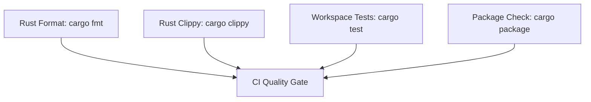

# CI & CD Pipeline Guide

This runbook describes the automated GitHub Actions pipelines in `.github/workflows/`.

---

## 1. Continuous Integration (CI)

The CI pipeline runs on pushes to `main` and on all pull requests targeting `main`.

### Workflows
- **`ci.yml`**: Compiles the Rust workspace, executes unit and integration tests across all packages, and verifies package manifest compatibility.
- **`pre-push-tests.yml`**: Runs `cargo fmt --all -- --check`, `cargo clippy --workspace --all-targets -- -D warnings`, and the test suite as an automated quality gate.
- **`codeql.yml`**: Performs automated static application security testing (SAST) for actions and Rust source.

---

## 2. Continuous Delivery (CD) - Publishing to crates.io

The CD pipeline in [`.github/workflows/cd.yml`](../.github/workflows/cd.yml) automates releasing all crates to [crates.io](https://crates.io/).

### Triggers
1. **Push of a release tag** matching `v*` (e.g., `git tag v0.3.1 && git push origin v0.3.1`).
2. **Manual dispatch** (`workflow_dispatch`) with optional `dry_run: true` flag.

### Execution Flow
1. **Validation**: Runs formatting checks, Clippy linter, and full workspace test suite.
2. **Preflight Guard**: Validates that all crate manifest versions match the git release tag before publishing any package.
3. **Topological Order**: Publishes crates in dependency order with automated crates.io API availability checks:
   - `codeatlas-domain`
   - `codeatlas-application`
   - `codeatlas-infrastructure`
   - `codeatlas-adapters`
   - `codeatlas-cli` (root CLI)
4. **Token Authentication**: Authenticates with `CARGO_REGISTRY_TOKEN` configured in GitHub Repository Secrets.
