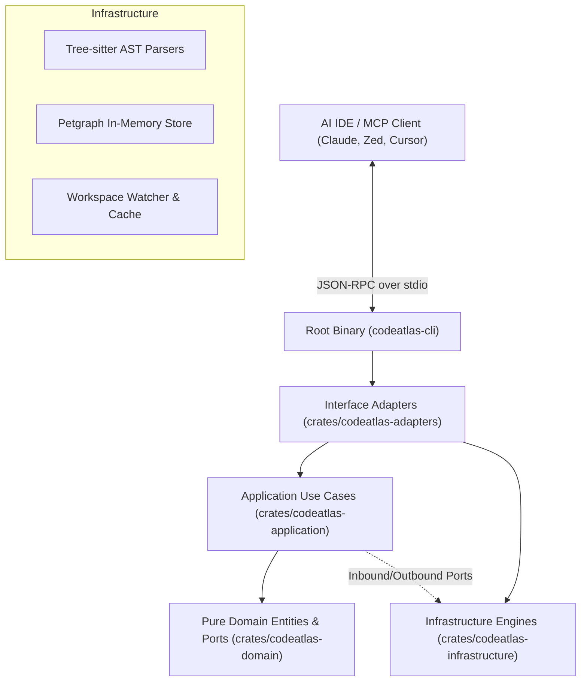

# MCP Server Architecture

CodeAtlas MCP Server is a high-performance, native Rust Model Context Protocol (MCP) server. It connects to AI clients (such as Claude Desktop, Zed, Cursor, and VS Code) through standard input/output (`stdio`) using JSON-RPC 2.0.

The codebase strictly adheres to **Clean Architecture & Domain-Driven Design (DDD)** across 5 modular crates.

---

## 🏛️ Clean Architecture Layers

### Layer Responsibilities

| Layer | Crate | Responsibilities |
| :--- | :--- | :--- |
| **Domain** | `codeatlas-domain` | Pure domain entities (`Project`, `CodeEntity`, `DependencyEdge`), value objects, and port traits (`AnalysisEnginePort`, `GraphStorePort`, `PlatformClientPort`). Zero external runtime dependencies. |
| **Application** | `codeatlas-application` | Orchestrates business workflows: `AnalyzeProjectUseCase`, `QueryGraphUseCase`, `SearchCodeUseCase`, `SecurityScanUseCase`, `SecondBrainUseCase`, and `ManageAdrUseCase`. |
| **Infrastructure**| `codeatlas-infrastructure`| Concrete port implementations: multi-language Tree-sitter parsers (Rust, TypeScript, JavaScript, Python, PHP), Petgraph directed graph store, file-system scanners, and in-memory caches. |
| **Adapters** | `codeatlas-adapters` | Delivery mechanics: MCP stdio transport, JSON-RPC 2.0 serialization/dispatch, CLI command routing (`doctor`, `setup-claude`, `setup-zed`), and outbound HTTPS client. |
| **Binary Entry** | `codeatlas-cli` | Root executable (`src/main.rs`) composing all dependency injection graphs with Tokio async runtime and jemalloc memory management. |

---

## 💾 Storage & Persistence Model

- **Local-First & In-Memory Graph**:
  - The dependency graph, call hierarchies, and entity metadata are loaded and indexed in-memory using Petgraph.
  - No external database server (Oracle, PostgreSQL, MySQL, Redis) is required.
  - Project registration markers and diagnostics are stored in user-isolated directories under `~/.codeatlas/`.
- **Optional Cloud Synchronization**:
  - If `CODEATLAS_API_KEY` and `CODEATLAS_API_URL` are provided in the environment, the server can synchronize dream memories and immune genes with an upstream CodeAtlas Platform API over HTTPS.
  - Outbound requests are strictly allowlisted to official CodeAtlas domains (`*.codeatlas.ai`, `opencode.ai`) or local loopback (`127.0.0.1`, `localhost`). Non-local unencrypted HTTP traffic is rejected.

---

## 🔒 Process & Security Boundaries

1. **Stdio Execution Model**:
   - The server runs as a dedicated child process attached to the client IDE.
   - It exposes no network listening ports, preventing unauthorized network ingress.
2. **Single-Tenant OS Permissions**:
   - The process executes with the privileges of the local user running the editor.
   - Access is restricted to the workspace directories configured by the client.
3. **Static Analysis Safety**:
   - Code parsing is performed statically without executing code files or evaluating runtime bytecode.
