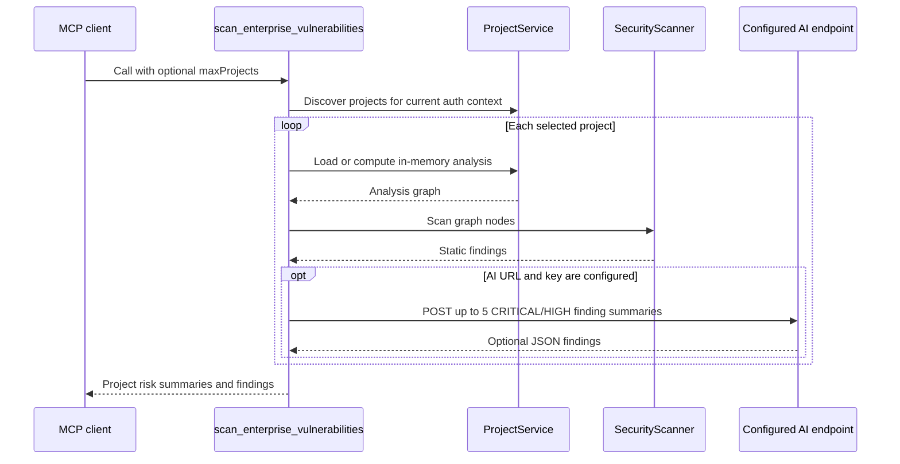

# Security Scanner

## What it does

The `scan_enterprise_vulnerabilities` MCP tool scans projects discovered by `ProjectService`. Its built-in scanner inspects nodes in the in-memory analysis graph for possible secret-like variable names, selected unsafe function names, and selected database-style function names. These are pattern-based signals, not source-level verification or a complete vulnerability analysis.

The tool can also call an AI endpoint when explicitly configured. Despite the default model label, the server does not identify or select a provider automatically. AI scanning requires `CODEATLAS_SCAN_AI_URL` (or `OPENCODE_BASE_URL`) and `CODEATLAS_SCAN_AI_KEY` (or `OPENCODE_API_KEY`); `CODEATLAS_SCAN_AI_MODEL` selects the model label. The POST uses a chat-style `model` and `messages` payload, `temperature: 0.1`, and `max_tokens: 1024`, with the AI key in a Bearer authorization header. It sends at most five CRITICAL/HIGH static finding summaries with file paths and line numbers. It does not send source excerpts in this request. HTTPS is required except for loopback HTTP, and redirects are rejected. If configuration is absent or the request fails, the static findings are returned.

## Runtime flow

The scanner skips paths whose names match test, mock, scratch, or diagnostic patterns. Static rules are currently:

| Finding | Rule | Severity assigned |
|---|---|---|
| `HARDCODED_SECRET` | Variable label contains a configured secret-related word such as `api_key`, `password`, or `token` | HIGH |
| `UNSAFE_FUNCTION` | Function label exactly matches `eval`, `exec`, `system`, `child_process`, `spawn`, or `shell_exec` (case-insensitive) | CRITICAL |
| `SQL_INJECTION_RISK` | Function label contains `Query` or `execute`, with exclusions for exact `execute` and names ending in `UseCase` | MEDIUM |

The SQL rule is a name heuristic: it does not inspect query construction or verify whether parameters are bound. The secret rule also flags names, not secret values. AI results are appended to the report and are not independently validated as true positives.

## Data and related tools

`scan_enterprise_vulnerabilities` scans the in-memory graph models and returns structured risk findings. It operates locally without writing findings to any database. The separate `scan_immune_genes`, `save_immune_gene`, and Genome tools communicate with the configured CodeAtlas API over HTTPS when cloud credentials are provided. See [the architecture overview](overview.md) for credential and destination behavior.

Tool registration and MCP delivery: [`crates/codeatlas-adapters/src/mcp/tools/security_tools.rs`](../../crates/codeatlas-adapters/src/mcp/tools/security_tools.rs). Security scan use case logic: [`crates/codeatlas-application/src/use_cases/security_scan.rs`](../../crates/codeatlas-application/src/use_cases/security_scan.rs).
